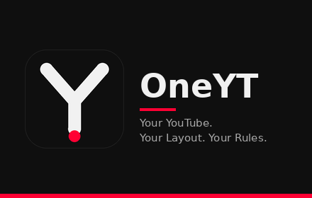

# OneYT — All-in-One YouTube Customizer

> "Your YouTube. Your Layout. Your Rules."

A lightweight, modular, privacy-first browser extension (Manifest V3)
that customises YouTube's player, layout, sidebar, themes, playback,
recommendations, focus mode and keyboard shortcuts — with every
feature independently toggleable. No backend, no account, no data
leaves the device.

**Status:** v1.0.0 — public release, all phases complete and
merged to `main` (PR #7, 2026-11-09). Chrome Web Store
submission is prepared (see `docs/SUBMISSION.md`); the listing
is live once the store review passes.



## What it does

- **Player** — width, alignment and position (including a fixed
  or absolute player that stays visible while you scroll),
  mini-player size and position, radius, borders and shadows
- **Sidebar** — independent scrolling with its own width,
  scrollbar and scroll sensitivity; compact density, card size
  and metadata controls
- **Layout** — hide comments and Shorts, home grid columns,
  card spacing and thumbnail size
- **Appearance** — six themes plus a custom theme with your own
  colours, typography, radius, spacing and validated custom CSS
- **Playback** — default speed and volume (remembered across
  videos), speed presets, quality, autoplay, captions and
  caption font size
- **Productivity** — Focus Mode (hide recommendations, chat,
  comments and navigation — restored exactly on exit),
  keyboard shortcuts (Shift+ by default, fully rebindable),
  guide navigation controls
- **Settings dashboard** — every setting in one searchable
  dashboard with live preview, import/export with diff preview,
  per-setting, per-section and global reset, and optional Chrome
  sync (opt-in; Custom CSS and remembered playback never sync)

## Privacy

OneYT stores settings locally in your browser. It makes no
network requests, collects no data, shows no ads and has no
backend. See [docs/PRIVACY.md](docs/PRIVACY.md).

## Install

**Chrome Web Store:** (link once the listing is live)

**Load unpacked (development):**

1. Clone this repo and open `chrome://extensions`.
2. Enable Developer mode, click "Load unpacked" and select
   this folder.
3. Open any YouTube page — click the OneYT icon for quick
   toggles, or open the full dashboard for every setting.

## Develop

```sh
npm install
npm test        # node:test suite (121 tests)
npm run lint    # ESLint
npm run format  # Prettier
npm run package # builds oneyt-1.0.0.zip for the store
```

No framework, no bundler, no build step for the extension
itself — vanilla JS/HTML/CSS, Manifest V3, classic scripts
sharing one `OneYT` global. See
[Architecture.md](Architecture.md) for the module system and
settings schema.

## Project docs

| File | What it answers |
|------|-----------------|
| [PRD.md](PRD.md) | What to build, who it is for, features, Definition of Done |
| [Architecture.md](Architecture.md) | App flow, module system, settings schema, folder structure |
| [Rules.md](Rules.md) | What to use / avoid, error handling, boundaries for AI |
| [Phases.md](Phases.md) | Phase 0–7 build plan with per-phase checklists |
| [Design.md](Design.md) | Brand, colours, themes, fonts, popup/dashboard layout |
| [Memory.md](Memory.md) | Progress tracker — what is done, what is next, what is blocked |
| [CHANGELOG.md](CHANGELOG.md) | Release history |
| [docs/store-listing.md](docs/store-listing.md) | Store listing copy |
| [docs/PRIVACY.md](docs/PRIVACY.md) | Privacy policy |
| [docs/SECURITY_REVIEW.md](docs/SECURITY_REVIEW.md) | Phase 6 security & privacy review |
| [docs/PERFORMANCE_AUDIT.md](docs/PERFORMANCE_AUDIT.md) | Phase 6 performance audit |
| [docs/SELECTOR_AUDIT.md](docs/SELECTOR_AUDIT.md) | Phase 6 selector audit |
| [docs/BUG_BASH.md](docs/BUG_BASH.md) | Phase 6 bug bash log |
| [docs/SUBMISSION.md](docs/SUBMISSION.md) | Store submission checklist |
| [docs/SCREENSHOTS.md](docs/SCREENSHOTS.md) | Screenshot shot list |

## Contributing

OneYT is a personal project by Shanto Paul. Issues and
suggestions are welcome at
https://github.com/shantopaul/OneYT/issues — please include
your browser version, the OneYT version (dashboard → About)
and the steps to reproduce.

## License

MIT — see [LICENSE](LICENSE).
